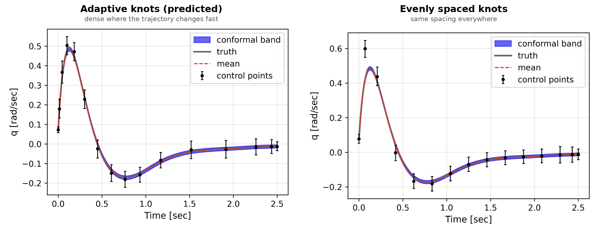

Jasmine Ratchford, Raffaele Romagnoli (Duquesne University), and Mark H. Klein (CMU Software Engineering Institute)
This page gives a bit more context on the work: two companion papers on predicting where an autonomous system will go, with calibrated uncertainty, fast enough for an onboard computer.

<p align="center">
  
</p>
---

## Our Published Results:

**1. Building Hybrid B-Spline and Neural Network Operators**

[link to arXiv](https://arxiv.org/abs/2406.06611) Presented at IEEE CDC 2024.

We propose learning B-spline control points for the nonlinear quadrotor directly from the initial condition, using evenly spaced knots, and prove that the approach is a universal approximator with bounded error.

**2. A Neural Network Approach towards Real-Time Knot Point Density Estimates for the Nonlinear Quadrotor**

[link to arXiv](https://arxiv.org/abs/2610.42027) To be presented at IEEE CDC 2026.

A small network predicts how "busy" a trajectory will be (its jerk activity) from the initial condition, so we can place spline knots where the dynamics change most rapidly; a least-squares fit then gives the control points. The network runs in about 2 ms on a Raspberry Pi Zero 2 W.

**3. Spectral and Conformal: Neural Network Methods for Calibrated Trajectory Prediction and Control-Point Intervals**

[link to work](https://openreview.net/forum?id=zKLMev1mnQ)

We develop a spectral neural network that predicts a full trajectory from its initial condition, use conformal quantile regression to wrap it in a calibrated whole-trajectory uncertainty band, and map that band to B-spline control-point intervals that can be checked against safety constraints, all in about 10 ms on a Raspberry Pi Zero 2 W.

### How they fit together

All of these papers represent trajectories as **B-splines**. A B-spline always stays inside the convex hull of its control points, so you can check a convex safety constraint on a handful of control points instead of on every point of the trajectory.

- The **knot-placement paper** decides *where* the spline's knots go. Dense knots during fast early corrections, sparse knots during the slow settle, set by a tolerance you choose at inference time with no retraining.
- The **TMLR paper** decides *what the trajectory is* and *how uncertain we are about it*. It turns calibrated bands into control-point intervals.

Run together, they form one pipeline: initial condition → knots → trajectory + bands → control-point intervals → safety check.

| Stage (Raspberry Pi Zero 2 W) | Mean latency |
|---|---|
| Knot placement (activity model) | 2.07 ms |
| Spline basis construction | 1.48 ms |
| Trajectory prediction (spectral NN) | 3.45 ms |
| Control-point intervals | 2.81 ms |
| **Total** | **9.81 ms (~100 Hz)** |

The test case for both papers is a nonlinear 12-state quadrotor under closed-loop LQR control.

---

## Who might find this useful

- **Safety-critical control and verification:** people working on safety filters, reference governors, reachability, or runtime assurance who want a fast alternative to numerical integration that still carries a probabilistic guarantee.
- **Robotics and UAVs:** motion planning and onboard feasibility checks on small, low-power hardware.
- **Uncertainty quantification and conformal prediction:** a worked example of joint (whole-trajectory) conformal coverage applied to smooth dynamical systems, with the guarantee carried over to spline coefficients.
- **Scientific ML community:** a spectral "lift, evolve, project" architecture with stability built in by capping the learned eigenvalues, without an autoencoder.
- **Spline and approximation theory:** curvature- and jerk-driven adaptive knot placement predicted directly from initial conditions.

**Possible applications:** onboard admissibility checks for drone waypoints or reference trajectories, fast "what-if" screening of many candidate maneuvers, compact uncertainty-aware trajectory messages for planners or multi-agent coordination, and surrogate models for other stable ODE systems.

---

## Open questions and next steps

These are directions we're excited about. If any of them overlap with your work, I'd love to talk.

1. **Beyond stable systems.** Does the approach hold up on other ODEs (for example, the Duffing oscillator), and how badly does it break on chaotic systems like the Lorenz attractor, where stability and fixed-point assumptions no longer apply?
2. **Noise and covariate shift.** Our coverage guarantees assume noise-free initial conditions. Can weighted conformal prediction restore guarantees under realistic sensor noise, and what noise model would we need to justify?
3. **Tighter control-point intervals.** The current intervals are conservative. Restricting the band to dynamically valid (rate-bounded) functions should tighten them while keeping coverage. How much tighter in practice, and at what compute cost?
4. **From the spline fit to the true trajectory.** The guarantee currently covers the least-squares spline fit. Closing the gap needs a rigorous, physics-based bound on approximation error from the system's dynamics and actuator limits.
5. **From checking to repairing.** We can flag a reference as inadmissible. Next is *repairing* it: searching for a nearby safe reference fast enough to act as a deployable safety filter.
6. **Real hardware in the loop.** Both papers benchmark inference on a Raspberry Pi. The next step is integrating knot prediction and trajectory prediction on a flying platform and testing on more hardware.
7. **Learned vs. physics-based knots.** When is uneven knot placement worth it? Trajectories whose complexity is spread evenly gain less, so can we predict ahead of time which strategy to use?

---

## How to cite
R. Romagnoli, J. Ratchford, and M. H. Klein, "Building Hybrid B-Spline and Neural Network Operators," in *IEEE Conference on Decision and Control (CDC)*, 2024, pp. 3611–3617. [arXiv:2406.06611](https://arxiv.org/abs/2406.06611)

J. Ratchford and R. Romagnoli, "Spectral and Conformal: Neural Network Methods for Calibrated Trajectory Prediction and Control-Point Intervals," *Transactions on Machine Learning Research*, 2026. [OpenReview](https://openreview.net/forum?id=zKLMev1mnQ)

J. Ratchford, R. Romagnoli, and M. H. Klein, "A Neural Network Approach towards Real-Time Knot Point Density Estimates for the Nonlinear Quadrotor," to appear in *IEEE Conference on Decision and Control (CDC)*, 2026. [arXiv:2610.42027](https://arxiv.org/abs/2610.42027)

<style>
  .bibtex pre, .bibtex code { white-space: pre-wrap; word-break: break-word; font-size: 0.8em; }
</style>

<details class="bibtex" markdown="1">
<summary><strong>BibTeX</strong> (click to expand)</summary>
```bibtex
@inproceedings{romagnoli2024hybrid,
  title     = {Building Hybrid B-Spline and Neural Network Operators},
  author    = {Romagnoli, Raffaele and Ratchford, Jasmine and Klein, Mark H.},
  booktitle = {IEEE Conference on Decision and Control (CDC)},
  year      = {2024},
  pages     = {3611--3617}
}
@article{ratchford2026spectral,
  title   = {Spectral and Conformal: Neural Network Methods for Calibrated Trajectory Prediction and Control-Point Intervals},
  author  = {Ratchford, Jasmine and Romagnoli, Raffaele},
  journal = {Transactions on Machine Learning Research},
  year    = {2026},
  month   = October,
  url     = {https://openreview.net/forum?id=zKLMev1mnQ}
}

@inproceedings{ratchford2026knot,
  title     = {A Neural Network Approach towards Real-Time Knot Point Density Estimates for the Nonlinear Quadrotor},
  author    = {Ratchford, Jasmine and Romagnoli, Raffaele and Klein, Mark H.},
  booktitle = {IEEE Conference on Decision and Control (CDC)},
  year      = {2026},
  note      = {To appear. arXiv:2610.42027}
}
```

---

▶ [Watch the video overview](https://youtu.be/bjBo2bwbaxM) · [TMLR Video](tmlr) · [Code](https://github.com/cmu-sei/bspline_net)

---
## Get in touch

Questions, ideas, or interested in collaborating? Reach out to **[jratchfo.github.emboss026@passmail.com]**.
